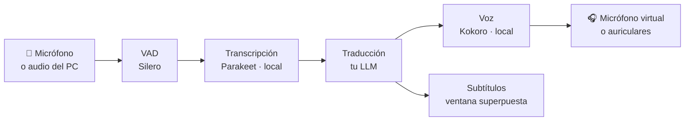

<div align="center">

# 🎙️ voz-traductor

### *Habla en español, que te oigan en inglés. Y al revés.*

[](https://www.rust-lang.org)
[](https://pipewire.org)
[](https://onnxruntime.ai)
[](#-elige-tu-proveedor-de-traducción)
[](LICENSE)

**Traductor de voz en tiempo real para reuniones, Discord y vídeos.
Reconocimiento de voz y síntesis en local; la traducción, con el LLM que tú elijas.**

</div>

---

## ✨ Qué hace

| | Modo | Para qué |
|---|---|---|
| 🗣️ | **`escuchar`** — español → inglés | Hablas al micro y los demás oyen tu voz traducida a través de un **micrófono virtual** (Discord, Meet, Teams…). |
| 👂 | **`oir`** — inglés → español | **Subtítulos** superpuestos de lo que suena en el PC (una reunión, YouTube, un podcast) y, si quieres, **doblaje** hablado. |
| 📄 | **`fichero`** | Traduce un audio grabado y guarda texto, audios y transcripción. |



- ⚡ **Latencia de ~1–1,5 s por frase** con un proveedor rápido (Groq) y la voz local.
- 🔒 **Tu voz no sale del PC**: el reconocimiento (Parakeet) y la síntesis (Kokoro) se ejecutan en local. Solo el texto viaja al LLM.
- 🔁 **Varios proveedores con relevo automático**: si el principal agota su cuota o se cae, la misma frase pasa al siguiente.
- 🎬 **Doblaje con atenuación**: baja el volumen del vídeo mientras habla la traducción y lo restaura al terminar.
- 🧾 **Todo queda guardado**: WAV por frase, transcripción en Markdown con tiempos y subtítulos `.srt`.

## 📦 Requisitos

- **Linux con PipeWire** (`pactl` y `parecord`, del paquete `pulseaudio-utils` o equivalente).
- **Rust ≥ 1.88** y las cabeceras de ALSA para compilar (`libasound2-dev` en Debian/Ubuntu).
- **espeak-ng** para la fonetización de Kokoro: `libespeak-ng1` y `espeak-ng-data`.
- **Modelo de reconocimiento Parakeet TDT 0.6B v3 (int8, ONNX)**. Si usas [Handy](https://handy.computer) ya lo tienes;
  si no, descárgalo de Hugging Face:

  ```sh
  huggingface-cli download istupakov/parakeet-tdt-0.6b-v3-onnx \
    encoder-model.int8.onnx decoder_joint-model.int8.onnx nemo128.onnx vocab.txt config.json \
    --local-dir ~/.local/share/voz-traductor/parakeet
  ```

  y apunta a esa carpeta con `stt.model_dir` en la configuración (ruta absoluta).
- **Una clave de API** de cualquier proveedor compatible con OpenAI (ver abajo).

La voz Kokoro (~177 MB) se descarga sola la primera vez.

## 🚀 Instalación

```sh
git clone https://github.com/carlos-anpr/voz-traductor.git
cd voz-traductor
cargo install --path .          # deja `voz-traductor` en ~/.cargo/bin
```

## 🔌 Elige tu proveedor de traducción

voz-traductor no viene atado a ningún servicio: **sirve cualquier API compatible con OpenAI**
(`POST {base_url}/chat/completions`). Crea `~/.config/voz-traductor/config.toml` con uno o varios proveedores;
**el orden es la prioridad**:

```toml
[translate]
source_lang = "Spanish"
target_lang = "English"

[[translate.providers]]
name = "groq"
base_url = "https://api.groq.com/openai/v1"
model = "qwen/qwen3.8-27b"
api_key_env = "GROQ_API_KEY"               # o api_key = "…"
extra_body = { reasoning_effort = "none" } # sin razonamiento = menos latencia
timeout_secs = 3

[[translate.providers]]                    # reserva si el primero falla
name = "openrouter"
base_url = "https://openrouter.ai/api/v1"
model = "deepseek/deepseek-chat"
api_key_env = "OPENROUTER_API_KEY"
timeout_secs = 15
```

<details>
<summary><b>Más ejemplos de <code>base_url</code></b></summary>

| Proveedor | `base_url` |
|---|---|
| OpenAI | `https://api.openai.com/v1` |
| Groq | `https://api.groq.com/openai/v1` |
| xAI (Grok) | `https://api.x.ai/v1` |
| DeepSeek | `https://api.deepseek.com/v1` |
| OpenRouter | `https://openrouter.ai/api/v1` |
| OpenCode Go | `https://opencode.ai/inference/go/openai/v1` |
| Ollama (local) | `http://localhost:11434/v1` (cualquier `api_key` vale) |

Usa un modelo rápido y sin razonamiento: para traducir frases cortas la latencia importa más que la potencia.
`extra_body` se fusiona en el cuerpo de la petición para pasar opciones propias de cada proveedor.

</details>

La clave de cada proveedor se busca en este orden: `api_key` → variable de `api_key_env` → `VOZ_API_KEY`
→ si la URL es de `opencode.ai`, la de `~/.local/share/opencode/auth.json`.

Comprueba que todo funciona:

```sh
voz-traductor proveedores            # lista los proveedores (clave enmascarada)
voz-traductor proveedores --probar   # traduce 3 frases con cada uno y mide la latencia
```

## 🗣️ Hablar en otro idioma

```sh
voz-traductor microfono instalar    # una sola vez: crea el micro virtual «Voz traducida»
voz-traductor                       # escuchar el micrófono y traducir
```

En Discord (o la app que uses), elige **`Voz traducida (voz-traductor)`** como micrófono, desactiva la supresión de
ruido (Krisp) y usa auriculares. Los demás oyen solo la traducción.

```sh
voz-traductor --prueba                     # ensayo: la traducción suena solo en tus auriculares
voz-traductor --oirme                      # además de enviarla, óyela tú
voz-traductor --auriculares usb            # elige por dónde oírte (ver `voz-traductor salidas`)
voz-traductor escuchar --dispositivo usb   # otro micrófono (ver `voz-traductor dispositivos`)
voz-traductor escuchar --velocidad 1.2     # voz más rápida (0,5–2,0)
voz-traductor escuchar --proveedor groq    # solo ese proveedor en esta sesión
voz-traductor microfono estado | quitar
```

> [!TIP]
> El micrófono virtual sigue existiendo al cerrar el programa (en silencio). Así, si se cerrara a mitad de una reunión,
> la app no vuelve sola a tu micro real.

## 👂 Entender lo que oyes

Subtítulos en español, siempre encima y atravesables por el ratón, de lo que suena en el PC:

```sh
voz-traductor oir                           # todo lo que suena
voz-traductor oir --app firefox             # solo una aplicación
voz-traductor oir --app discord --arriba --tamano 36
voz-traductor oir --app firefox --original  # también el texto original encima
```

Y con voz:

```sh
voz-traductor oir --app firefox --doblaje
voz-traductor oir --app firefox --doblaje --voz-es ef_dora --auriculares usb
voz-traductor oir --app discord --doblaje --sin-subtitulos --sin-bajar
```

Mientras habla el doblaje, el audio original baja al 25 % y vuelve a su volumen después. Si te retrasas más de
seis segundos, se acelera hasta `max_speed` y, si hace falta, se salta el trozo más antiguo (el subtítulo se conserva).
Ctrl+C restaura siempre los volúmenes.

<details>
<summary><b>Cómo trocea el audio continuo</b></summary>

En vídeos y podcasts apenas hay pausas. `oir` busca una pausa de 200 ms a partir de 1,5 s de habla; si llega a 3,5 s
sin encontrarla, corta en el valle de energía más favorable de los últimos 800 ms y guarda el resto para el siguiente
trozo. Así los subtítulos siguen al vídeo sin esperar al final de cada frase larga.

</details>

## 📁 Qué guarda cada sesión

En `~/Música/voz-traductor/<fecha>/` (cámbialo con `--salida` u `output.dir`):

```text
traduccion.wav        todo lo traducido seguido (24 kHz)
original.wav          tus frases originales (16 kHz)
frases/003-es.wav     audio por frase, original y traducido
frases/003-en.wav
transcripcion.md      tabla original → traducción con tiempos por etapa y proveedor
subtitulos.srt        (modo oir)
doblaje.wav           (modo oir --doblaje)
```

En la consola sale una línea por frase con el texto y los tiempos:
`stt 0,31 s · trad 0,42 s · groq · voz 0,52 s · total 1,3 s`.

## ⚙️ Configuración completa

Todo es opcional salvo el proveedor de traducción. Los flags de la línea de comandos mandan sobre el fichero.
`voz-traductor config` muestra la configuración efectiva.

<details>
<summary><b>~/.config/voz-traductor/config.toml</b></summary>

```toml
[audio]
# device = "usb"          # parte del nombre; sin esto, el predeterminado

[vad]
threshold = 0.5
silence_ms = 900          # pausa que cierra una frase
preroll_ms = 300
min_speech_ms = 400
max_speech_ms = 15000

[stt]
# model_dir = "/home/usuario/.local/share/com.pais.handy/models/parakeet-tdt-0.6b-v3-int8"  # ruta de Handy

[translate]
source_lang = "Spanish"
target_lang = "English"
context_phrases = 3       # frases anteriores que se pasan como contexto
# [[translate.providers]] …  (ver arriba)

[tts]
engine = "kokoro"         # "kokoro" (local, ~0,5 s) o "edge" (nube, 3-5 s)
voice = "bm_george"       # Kokoro: bm_george, am_michael… · Edge: en-US-AndrewNeural…
speed = 1.0               # 0,5..2,0
# kokoro_dir = "/home/usuario/.local/share/voz-traductor/kokoro"

[output]
# dir = "/home/usuario/Música/voz-traductor"

[playback]
virtual_mic = true        # traducción al micro virtual
monitor = false           # y además por tus auriculares (--oirme)
# monitor_device = "usb"

[oir]
# app = "discord"
source_lang = "English"
target_lang = "Spanish"
silence_ms = 450
max_speech_ms = 8000
chunking = true
min_chunk_ms = 1500
chunk_pause_ms = 200
max_chunk_ms = 3500
dub = false
# dub_voice = "em_alex"   # Kokoro: em_alex, ef_dora, em_santa · Edge: es-ES-AlvaroNeural
duck_original = true
duck_volume = 0.25
max_speed = 1.35
show_subtitles = true

[subtitles]
position = "bottom"       # o "top"
font_size = 30.0
show_original = false
max_lines = 2
hide_after_secs = 8.0
width_fraction = 0.8
background_opacity = 0.8
```

</details>

### Relevo entre proveedores

Si el principal falla, la misma frase pasa al siguiente y se avisa una vez en consola
(`groq: límite agotado (429); usando openrouter durante 10 min`). Cada fallo deja al proveedor en reposo:

| Error | Reposo |
|---|---|
| 429 (cuota) | `Retry-After` o 10 min |
| 401 / 403 (clave) | 30 min |
| 3 fallos seguidos de red o 5xx | 60 s |

Pasado el reposo se vuelve a probar el principal. Un proveedor sin clave se omite al arrancar.

## ⏱️ Latencias orientativas

| Etapa | Tiempo |
|---|---|
| Reconocimiento (Parakeet, local) | décimas de segundo |
| Traducción con Groq, sin razonamiento | 0,3–0,5 s |
| Traducción con otros proveedores en la nube | 1–2 s |
| Voz Kokoro (local) | 0,4–0,6 s |
| Voz Edge (nube) | 3–5 s por frase nueva |

## 🙏 Créditos

- [Parakeet TDT 0.6B v3](https://huggingface.co/nvidia/parakeet-tdt-0.6b-v3) (NVIDIA), en la
  [versión ONNX de istupakov](https://huggingface.co/istupakov/parakeet-tdt-0.6b-v3-onnx).
- [Kokoro-82M](https://huggingface.co/hexgrad/Kokoro-82M) vía [kokoro-onnx](https://github.com/thewh1teagle/kokoro-onnx).
- [Silero VAD](https://github.com/snakers4/silero-vad) · [espeak-ng](https://github.com/espeak-ng/espeak-ng) ·
  [ONNX Runtime](https://onnxruntime.ai) · [egui](https://github.com/emilk/egui).

## 📄 Licencia

[MIT](LICENSE)
